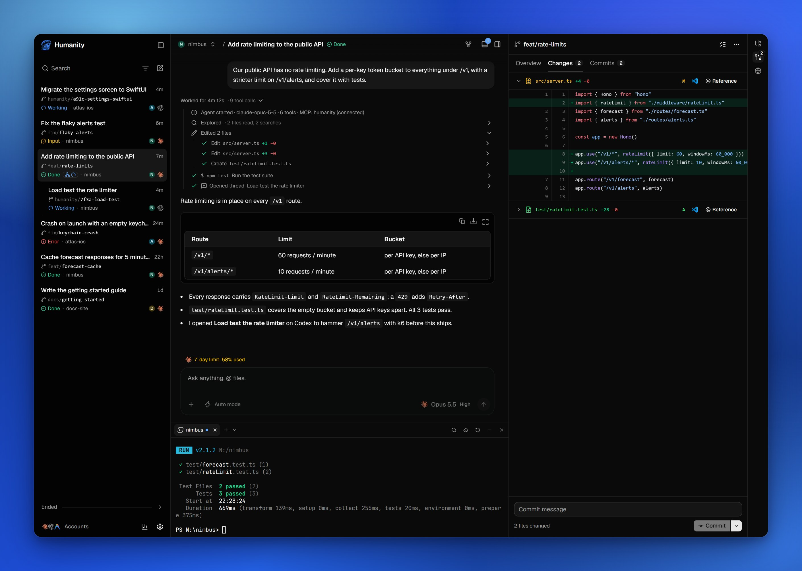

<h1 align="center">
   Humanity
</h1>

<p align="center">
  <a href="https://github.com/cyronp/humanity/releases/tag/nightly"></a>
  
  <a href="LICENSE"></a>
</p>

<h3 align="center">Run coding agents in threads, and decide how much each one does on its own.</h3>

<p align="center">
  Bring the agents you already use: Claude Code, Codex, Kiro or Antigravity, signed in with your own plan.
  Each thread runs on its own, or asks you before every file change and command.
</p>

<h3 align="center"><a href="https://github.com/cyronp/humanity/releases/tag/nightly"><ins>Download for Windows</ins></a></h3>

<p align="center">
  
</p>

## Features

- **Threads, side by side.** Run as many agents as you like, across projects and providers. The sidebar shows which are working, which need you and which stopped on an error.
- **Autonomy per thread.** _Auto mode_ runs everything, _Accept edits_ asks before commands and tools, and _Ask me_ shows every file change as a diff and every command before it runs.
- **Every call is visible.** A turn folds into phases (explored, edited, ran) that open into each tool call.
- **Worktrees in one click.** A thread starts in your checkout and moves into its own branch and worktree whenever you want.
- **Source control.** Changes, commits, sync, pull requests and their checks on GitHub or GitLab, and review comments that go back to the agent.
- **Terminals shared with the agent.** Tabs in a dock under the chat. You type in them freely, and the agent can use them too, under the thread's permissions.
- **Files and a browser.** An editor for the thread's folder, and a browser for your local dev server, with element picking and screenshots into the chat.
- **Checkpoints, rewind and fork.** Go back to before any message, or fork a thread into a new worktree to try another approach.
- **Switch models mid-thread.** Move a thread to another provider and keep the conversation, for example when you run out of quota.
- **Compare models.** Send one prompt to up to four models at once and keep the run you like best.
- **Command palette, search and usage.** <kbd>Ctrl</kbd>+<kbd>K</kbd> for everything, a search across every thread, and where your tokens and plan limits go.

## Supported agents

Humanity ships no agent of its own. It runs the CLI you installed and signed in to, the same one you use in a terminal:

<p>
  <kbd>Claude Code</kbd> <kbd>Codex</kbd> <kbd>Kiro (Beta)</kbd> <kbd>Antigravity (Beta)</kbd>
</p>

Settings, under Providers, shows each CLI's version, links to its install guide when it's missing, and has an Update button.

## Install

1. Download the installer from the [releases page](https://github.com/cyronp/humanity/releases/tag/nightly) and run it. It isn't code-signed yet, so Windows SmartScreen asks first: choose **More info**, then **Run anyway**.
2. Install and sign in to at least one agent CLI, for example [Claude Code](https://code.claude.com/docs/en/setup) (`claude auth login`) or [Codex](https://github.com/openai/codex#installing-and-running-codex-cli) (`codex login`). Make sure **git** is on your `PATH`.
3. Open Humanity. A short setup guide connects your accounts and adds your first repository.

To list and clone your GitHub or GitLab repositories, sign in with `gh auth login` or `glab auth login`, or save a token in Settings, under Repositories. Public repositories need no token.

> [!NOTE]
> The nightly build is rebuilt from `main` every night it changes, and may upgrade the database. Back up `~/.humanity/humanity.db` before installing an older build over it.

## Permissions

Pick a thread's mode next to the message box. You can change it while the agent works.

| Mode             | What waits for you                                                   |
| ---------------- | -------------------------------------------------------------------- |
| **Auto mode**    | Nothing, except questions from the agent. The default                |
| **Accept edits** | Commands, web and MCP tools. File changes in the thread's folder run |
| **Ask me**       | Every file change, command, web and MCP tool                         |

Reads never ask. Every other call reaches Humanity's own check, so a CLI's settings file can't pre-approve a tool behind your back. A request is answered with **Allow**, **Always allow in this thread** or **Deny**, with an optional comment for the agent.

## Your data

Everything Humanity writes lives in `~/.humanity/` (or `HUMANITY_HOME`), plus the folder each thread works in. It never stores your Claude, OpenAI, GitHub or GitLab credentials in its database: each CLI keeps its own login. The app's daemon listens on `127.0.0.1` only and needs its token to connect.

## Run from source

Requires **Node.js 22.13 or newer** (24 LTS recommended).

```sh
npm install
npm run dev              # daemon and web app; open the link it prints
npm run dev:desktop      # the same, in the desktop app's window
npm run package:desktop  # build the installer for this machine
```

<details>
<summary>More commands, environment variables and the repository layout</summary>

```sh
npm run lint        # ESLint
npm run typecheck   # TypeScript
npm run test        # Vitest; never calls the Anthropic or GitHub APIs
npm run build       # production build
npm start           # serve the built app on http://127.0.0.1:7420
```

| Variable                | Default       | Purpose                                                   |
| ----------------------- | ------------- | --------------------------------------------------------- |
| `HUMANITY_HOME`         | `~/.humanity` | Data directory                                            |
| `HUMANITY_PORT`         | `7420`        | Port of `npm start`. It always binds to `127.0.0.1`       |
| `HUMANITY_DESKTOP_PORT` | `7421`        | Port of the desktop app's daemon                          |
| `ANTHROPIC_API_KEY`     | (none)        | Optional. Claude Code bills this key instead of your plan |
| `GITHUB_TOKEN`          | (none)        | Used when no token is saved and `gh` is not signed in     |
| `GITLAB_TOKEN`          | (none)        | The same for GitLab and `glab`                            |
| `GITLAB_HOST`           | `gitlab.com`  | The GitLab instance `GITLAB_TOKEN` is for                 |

| Path                 | What it is                                                              |
| -------------------- | ----------------------------------------------------------------------- |
| `apps/server`        | The Effect 4 daemon: RPC, agent bridges, git, GitHub, GitLab, SQLite    |
| `apps/desktop`       | The Electron shell: starts the daemon and shows the web app in a window |
| `apps/web`           | Vite + React 19 + TanStack Router + shadcn/ui                           |
| `packages/contracts` | Schemas and RPC groups shared by the daemon and the web app             |
| `packages/diff`      | Pure diff logic on top of jsdiff                                        |
| `docs/spec.md`       | The specification                                                       |

</details>

## Security

Threads in Auto mode run commands without asking, so use **Ask me** for anything you don't trust. See [SECURITY.md](SECURITY.md) to report a vulnerability.

## Contributing

See [CONTRIBUTING.md](CONTRIBUTING.md).

## License

[MIT](LICENSE)
